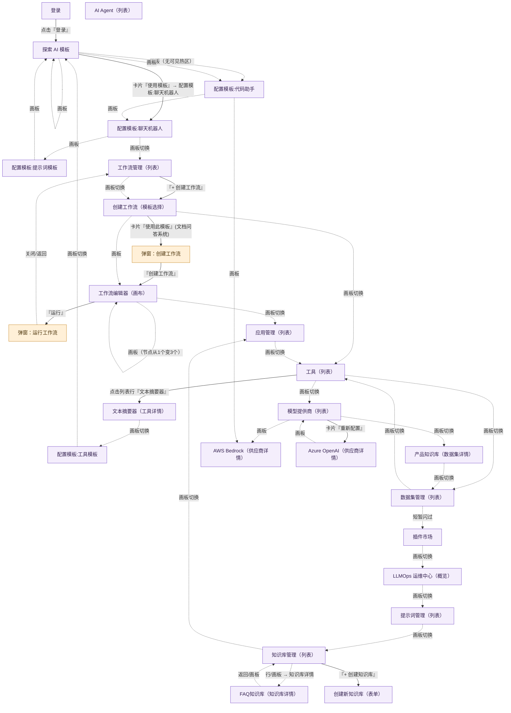

# 屏幕录制还原：AI 智能体应用开发平台（墨刀高保真原型，85 秒）

> 阅读范围：scene_001–scene_014 全部 + sec_001–sec_085 中逐秒实际查看的帧（除 sec_010 附近个别帧重复外，1–85 秒基本逐秒核对）。
> 时间基准：`sec_NNN` = 第 NNN 秒；画面左上角计时徽标显示 `NNN-1` 秒，整体存在固定 1 秒偏移，本文按帧号计时。
> 左屏外框是墨刀编辑器（`画布(63)` 画板列表 + `总览/演示` 切换 + 底部 `1/1`、`网页 1920`），右侧紫色框内是**被演示的原型页面本身**。后文"应用内左侧导航"专指原型页面里的导航（探索/工作流/应用中心/知识库/Agent/提示词工程/LLMOps监控/插件市场/数据集/工具/模型厂商）。

## 一、时间线

| mm:ss | 发生了什么 | 涉及页面/组件 | 依据 |
|---|---|---|---|
| 0:01 | 录屏起始页为登录页：紫色渐变背景 + 浮动图标，居中白色登录卡（Logo、"AI智能体应用开发平台"、邮箱地址、密码+眼睛图标、"记住我"、"忘记密码?"、登录按钮、Google/GitHub 三方登录、"还没有账户？立即注册"） | 登录 | sec_001、scene_001 之前的初始态 |
| 0:02 | 鼠标移到"登录"按钮上，按钮出现描边/变亮（hover 态），随后点击 | 登录 / 登录按钮 | sec_002 |
| 0:03 | 进入原型内页"探索 AI 模板"。应用内左侧导航首次出现（11 项），"探索"高亮。4 个指标卡：16 总模板数 / 5 热门模板 / 4 收藏模板 / 11.8K 总使用次数 | 探索 AI 模板 | sec_003、scene_001 |
| 0:04 | 光标移到"聊天机器人"卡片底部"使用模板"按钮（橙色描边 hover） | 探索 AI 模板 / 模板卡片 | sec_004 |
| 0:05 | 跳到"配置模板:聊天机器人"：返回箭头 + 标题；说明卡（"创建一个智能对话机器人，可以回答用户问题并进行自然对话" + 标签 AI对话/客服/助手）；模板配置表单（机器人名称*、性格设定*下拉、知识领域、欢迎语*多行）；底部 取消 / 创建模板。**所有输入框为空，无敲字** | 配置模板:聊天机器人 | sec_005、sec_006 |
| 0:07 | 跳到"工作流管理"列表：右上"+ 创建工作流"（橙色高亮 hover）；表格列 工作流/节点数量/状态/最后运行/成功率/创建时间/操作，8 行数据，状态徽标 已发布(绿)/草稿(灰)/运行中(蓝) | 工作流管理 | sec_007 |
| 0:08 | 跳到"创建工作流"（模板选择页）：说明"选择模板快速开始，或创建空白工作流自定义构建" + 选择分类 chips（全部/客服/文档处理/语音处理/开发工具/办公自动化/数据分析/AI代理/自定义）+ 工作流模板 6 卡（智能聊天机器人、文档问答系统、多语言翻译器、代码审查助手、邮件智能分类、数据分析报告）+ 底部 AI智能代理、空白工作流。"文档问答系统"的"使用此模板"为紫色实心 | 创建工作流（模板页） | sec_008、scene_007 |
| 0:09 | 点击该"使用此模板"→ 居中弹出"创建工作流"模态框（背后画板压暗）：工作流名称* = `文档问答系统`（自动带入）、描述 = `上传文档并基于文档内容进行智能问答`、工作流类型 = 工作流（下拉）、模板功能 = 文档解析 / RAG检索 / 答案生成（标签）、取消 / 创建工作流。光标停在"创建工作流" | 弹窗：创建工作流 | sec_009、scene_002、scene_003 |
| 0:10 | 进入工作流编辑器画布：左"节点库"9 项（开始/LLM/Agent/知识检索/问答/代码执行/HTTP请求/数据转换/条件判断/结束），顶部标题 `智能客服工作流` + `草稿` 角标 + 运行/保存/设置/分享/折叠按钮，右侧"节点属性"（节点名称=开始、描述、"节点配置"）。画布上**只有"开始"一个节点** | 工作流编辑器（节点库-开始） | sec_010、scene_004 |
| 0:11 | 光标移到顶部"运行"按钮上（按钮高亮），点击 | 工作流编辑器 / 运行 | sec_011 |
| 0:12 | 弹出"运行工作流"模态框：说明"请输入测试数据来运行工作流"、输入内容 textarea（占位 `请输入测试内容...`，**为空**）、运行结果框（`点击运行按钮查看结果..`）、关闭 / 运行。此时背后画布上已出现 **开始 / LLM / 数据转换 / 条件判断 / 结束** 多个节点（比 0:10 多） | 弹窗：运行工作流 | sec_012、scene_005 |
| 0:13 | 跳回"工作流管理"列表 | 工作流管理 | sec_013、scene_006 |
| 0:13–0:14 | 又跳回"创建工作流"模板页，"文档问答系统 / 使用此模板"再次紫色高亮 | 创建工作流（模板页） | sec_014 |
| 0:14 | 跳到"工具"列表（应用内"工具"高亮）：+ 创建工具；表格列 工具/类型(API徽标)/输入参数/输出格式/状态(可用)/操作，10 行（文本摘要器、语言翻译器、情感分析器、代码生成器、图像分类器、数据验证器、文本提取器、网页爬虫、邮件解析器、JSON格式化器） | 工具 | sec_015、scene_008 |
| 0:15 | 跳到"数据集管理"列表：+ 创建数据集；列 数据集/类型(文本|图像|视频|音频)/记录数/大小/状态(已完成|处理中|失败|待处理)/最后更新/操作（上传图标 + 更多）；8 行，每行带细进度条（100%/75%/60%/45%） | 数据集管理 | sec_016 |
| 0:15 中段 | **短暂闪过"插件市场"**（不足 1 秒，逐秒帧未捕获）：+ 开发者中心；搜索插件；分类=全部、排序=最受欢迎；分类 chips（全部/AI模型/数据源/API集成/语音处理/数据分析/安全工具）；6 张插件卡（OpenAI GPT-4 Turbo、Claude 3 Sonnet、PostgreSQL 连接器、Slack 集成、多语言翻译引擎、数据可视化套件），每卡有 评分/下载量/价格(免费|$xx/月)/安装按钮 | 插件市场 | scene_009 |
| 0:16 | 跳到"LLMOps 运维中心"：右上 设置 / 告警中心 / 生成报告；Tab：概览(激活)/模型监控/成本管理/A/B测试/安全合规；6 个指标卡（45,892 总请求数、847ms 平均延迟、0.34% 错误率、99.97% 可用性、12.4M Token消耗、$2,847 运营成本，均带环比）；下方"系统健康状态"（绿色长条 + 系统可用性 99.7%）与"活跃告警"（2 个未解决告警、Llama-2-70B 高错误率、Gemini Pro 延迟增加、查看全部） | LLMOps 运维中心（概览） | sec_017、scene_010 |
| 0:17 | 跳到"提示词管理"列表：+ 创建提示词；列 提示词/类型/模型/状态/版本/最后修改/操作，8 行（智能客服助手、文档摘要生成器、多语言翻译器、情感分析器、代码解释器、创意写作助手、数据分析报告、邮件回复助手），模型列显示 GPT-4 / GPT-3.5-turbo，版本 v1.2/v0.8/v2.1… | 提示词管理 | sec_018 |
| 0:18 | 跳到"知识库管理"列表：+ 创建知识库；列 名称/文档数量/大小/向量化状态(已完成|处理中|失败|待处理)/最后更新/创建时间/操作（刷新 + 更多），8 行（产品文档知识库、FAQ知识库、技术文档库、法律合规文档、培训资料库、市场营销素材、研发文档库、客户案例库），部分行带进度条 | 知识库管理 | sec_019 |
| 0:19 | 跳到"应用管理"列表：+ 创建应用；列 应用/类型/状态(运行中|维护中|测试中)/使用次数/最后修改/创建时间/操作，10 行（智能招聘助手、智能客服助手、代码审查机器人、产品需求分析师、数据洞察分析师、多语言翻译专家、AI面试官、法律文档助手、医疗诊断助手、教育课程设计师） | 应用管理 | sec_020 |
| 0:20 | 又回到"工具"列表（同 0:14 内容） | 工具 | sec_021 |
| 0:21 | 跳到"模型提供商"：+ 添加供应商；Tab：所有提供商(激活)/已连接/云服务/本地部署；6 张供应商卡（OpenAI、Anthropic、Google AI、Azure OpenAI、Ollama、Hugging Face），每卡含 云服务|本地部署|API接口 标签、已连接|未连接|错误 徽标、右上角开关、支持模型 chip 列表、右下"重新配置/配置"按钮 | 模型提供商 | sec_022 |
| 0:22 | 页面仍为"模型提供商"，光标停在墨刀左侧"画布(63)"列表的"知识库"上（鼠标不在原型画布内） | 模型提供商 / 墨刀画板列表 | sec_023 |
| 0:23 | 画面切到"FAQ知识库"详情页：标题 + 描述（常见问题解答和客服对话记录）、文档统计（文档数量 89 / 总大小 15 MB）、向量化状态=处理中 + 进度条 65%、配置信息（嵌入模型 text-embedding-ada-002、分块大小 800、分块重叠 150）、时间信息（创建时间 2024-01-14、最后更新 30分钟前）；右侧"快速操作"：编辑知识库 / 重新索引 / 下载知识库 / 删除知识库 | 知识库详情（FAQ知识库） | sec_024 |
| 0:24 | **内容区白屏**：应用内导航仍在（知识库高亮），右侧正文区完全空白 | 过渡空白帧 | sec_025 |
| 0:25 | 跳到"知识库管理"列表（同 0:18 内容，状态徽标在变化：FAQ知识库=处理中、技术文档库=已完成…） | 知识库管理 | sec_026 |
| 0:26 | 同页，光标移到右上"+ 创建知识库"按钮 | 知识库管理 / 创建知识库 | sec_027 |
| 0:27 | 进入"创建新知识库"表单页（无返回箭头）：知识库名称*、知识库描述、知识库类型（下拉）、数据源、标签(逗号分隔)、创建知识库按钮。全空 | 创建新知识库 | sec_028 |
| 0:28 | 跳到"AI Agent"列表（标题写 AI Agent，右上 + 创建Agent）：列 Agent/策略(工具数量/状态/最后运行/创建时间)，8 行，策略徽标 Function Calling / ReAct / Chain of Thought；应用内导航此时半透明渐隐 | AI Agent 列表 | sec_029 |
| 0:29 | 内容区空白，仅紫色顶栏（导航也消失） | 过渡空白帧 | sec_030 |
| 0:30 | 内容区仍空白，应用内导航重新出现，"工作流"高亮 | 过渡空白帧 | sec_031 |
| 0:31 | 内容区仍空白，"工具"高亮 | 过渡空白帧 | sec_032 |
| 0:32 | 内容区加载出"创建工作流"模板页（同 0:08 内容）；此帧应用内导航高亮项为"工具"（与页面不符） | 创建工作流（模板页） | sec_033 |
| 0:33 | 光标悬停"文档问答系统"的"使用此模板"（紫色实心 + 手型光标） | 创建工作流 / 模板卡片 | sec_034 |
| 0:34 | 再次弹出"创建工作流"模态框（内容与 0:09 完全一致），光标在"创建工作流"上 | 弹窗：创建工作流 | sec_035、scene_011、scene_012 |
| 0:35 | 进入工作流编辑器画布（智能客服工作流），画布仍只有"开始"节点；光标在顶栏右侧通知铃铛附近 | 工作流编辑器 | sec_036、scene_013 |
| 0:36 | 同页静止 | 工作流编辑器 | sec_037 |
| 0:37 | 内容区变空、应用内导航开始淡出（"工作流"仍高亮） | 过渡空白帧 | sec_038 |
| 0:38 | 画面只剩紫色顶栏，正文全白（导航完全消失） | 过渡空白帧 | sec_039 |
| 0:39 | 导航出现、"探索"高亮，正文区仍空白 | 过渡空白帧 | sec_040 |
| 0:40 | "探索 AI 模板"内容加载完成；前两张卡（聊天机器人、代码助手）的"使用模板"出现橙色描边 hover，光标停在模板区 | 探索 AI 模板 | sec_041 |
| 0:41 | 跳到"配置模板:代码助手"（无应用内导航，导航稍后淡入）：说明"协助编写、调试和优化代码" + 标签 编程/开发/调试；模板配置：助手名称*、编程语言*下拉、专业领域*下拉、代码风格；取消 / 创建模板 | 配置模板:代码助手 | sec_042 |
| 0:42 | 同页；应用内导航整块出现并带大面积橙色底/描边（多行同时高亮，知库项紫色），光标在导航区 | 配置模板:代码助手 | sec_043 |
| 0:43 | 跳到"配置模板:聊天机器人"（表单同样为空的镜像页）；导航仍带橙色高亮块，"工作流"紫色 | 配置模板:聊天机器人 | sec_044 |
| 0:44 | 同页静止 | 配置模板:聊天机器人 | sec_045 |
| 0:45 | 正文空白，"探索"高亮 | 过渡空白帧 | sec_046 |
| 0:46 | 跳到"配置模板:提示词模板"：说明"创建高质量的AI提示词模板，优化AI交互效果" + 标签 AI提示/模板库/效率优化；配置：提示词名称*、AI模型*下拉、使用场景*下拉、提示词模板*多行；取消 / 创建模板 | 配置模板:提示词模板 | sec_047 |
| 0:47 | 回到"探索 AI 模板"（前两张卡"使用模板"橙色 hover） | 探索 AI 模板 | sec_048 |
| 0:48 | 跳到"配置模板:代码助手"（导航正在淡入，处于半透明） | 配置模板:代码助手 | sec_049、scene_014 |
| 0:49–0:50 | 同页静止，光标从画布移到左侧"画布(63)"列表并向下滚动（列表滚到"数据集 / 工具 / 模型厂商"分组） | 配置模板:代码助手 / 墨刀画板列表滚动 | sec_050、sec_051 |
| 0:51 | 同页；光标停在画布列表"模型-Google"项 | 配置模板:代码助手 / 墨刀画板列表 | sec_052 |
| 0:52 | 画面切到供应商详情"AWS Bedrock"：API 密（`aws...stu901`）、可用模型（Titan, Jurassic）、状态（活跃）、创建时间（2023-11-01）；右侧"提供商操作"：测试连接 / 更新 API 密钥 / 查看使用统计 / 移除提供商 | 模型厂商详情（AWS Bedrock） | sec_053 |
| 0:53 | 回到"模型提供商"列表（导航"模型厂商"紫色）；多个"配置 / 重新配置"按钮出现橙色 hover 块 | 模型提供商 | sec_054 |
| 0:54–0:55 | 同页静止；光标在 Azure OpenAI 卡的"重新配置" | 模型提供商 | sec_055、sec_056 |
| 0:56 | 切到供应商详情"Azure OpenAI"：API 密（`az...pqr678`）、可用模型（GPT-4, GPT-3.5）、状态（未激活）、创建时间（2023-11-03）、同一组"提供商操作" | 模型厂商详情（Azure OpenAI） | sec_057 |
| 0:57–0:58 | 同页静止 | 模型厂商详情（Azure OpenAI） | sec_058、sec_059 |
| 0:59 | 跳到"产品知识库"数据集详情：描述（包含所有产品相关的文档和说明）、文档数量 156个文档、大小 2.3 GB、创建时间（值为空）；右侧"数据集操作"：添加文档 / 导出数据集 / 查看统计 / 删除数据集（红字） | 数据集详情（产品知识库） | sec_060 |
| 1:00–1:01 | 同页静止（光标由画布移到左侧画布列表"数据集管理"） | 数据集详情（产品知识库） | sec_061、sec_062 |
| 1:02 | 切到"数据集管理"列表（同 0:15 内容）；此刻应用内导航高亮项为"插件市场"（与页面不符） | 数据集管理 | sec_063 |
| 1:03–1:07 | 同页静止约 5 秒，光标在左侧"画布(63)"列表里上下移动（列表已滚动） | 数据集管理 / 墨刀画板列表 | sec_064–sec_068 |
| 1:08 | 切到"工具"列表；"+ 创建工具"按钮橙色 hover，第一行"文本摘要器"整行橙色高亮 | 工具 | sec_069 |
| 1:09 | 同页（导航高亮"模型提供商"） | 工具 | sec_070 |
| 1:10 | 进入工具详情"文本摘要器"：描述（将长文本总结为关键要点）、输入（长文本文档）、输出（摘要文本）、创建时间（2023-11-15）；右侧"工具操作"：运行工具（紫色实心）/ 编辑配置 / 查看使用统计 / 删除工具 | 工具详情（文本摘要器） | sec_071 |
| 1:11 | 跳到"配置模板:工具模板"（说明"创建各种实用工具，提高工作效率" + 标签 效率工具/自动化/实用工具；配置：工具名称*、工具分类*、输入类型*、输出类型*；取消 / 创建模板）。此帧没有应用内导航 | 配置模板:工具模板 | sec_072 |
| 1:12 | 同页；导航出现并带橙色高亮块，"数据集"紫色 | 配置模板:工具模板 | sec_073 |
| 1:13–1:14 | 同页静止，光标移到左侧画布列表"LLM"附近 | 配置模板:工具模板 | sec_074、sec_075 |
| 1:15 | 正文空白，导航淡出中（可见半透明侧栏） | 过渡空白帧 | sec_076 |
| 1:16 | 正文空白，导航完整可见，"工作流"高亮 | 过渡空白帧 | sec_077 |
| 1:17 | 回到工作流编辑器：画布上出现 3 个节点 **开始 / Agent / LLM**，右侧"节点属性"显示 节点名称 = Agent（Agent 节点带紫色选中描边） | 工作流编辑器（节点库-Agent） | sec_078 |
| 1:18 | 同页静止 | 工作流编辑器 | sec_079 |
| 1:19 | 跳到"应用管理"列表，此帧**没有应用内导航**，表格铺满 | 应用管理 | sec_080 |
| 1:20 | 应用管理（导航出现，"工作流"高亮）；光标在左侧画布列表"智能客服助手"上 | 应用管理 / 墨刀画板列表 | sec_081 |
| 1:21–1:23 | 同页静止，光标在画布列表内移动（应用管理、模型-Google、模型-Hugging Face 等） | 应用管理 / 墨刀画板列表 | sec_082–sec_084 |
| 1:24 | 录制结束：计时徽标变为"01:24"并展开出暂停/停止/笔 控件，画面停在"应用管理" | 应用管理（录制控件） | sec_085 |

## 二、页面跳转图

实线 = 画面里看到了触发动作（点击目标/hover 目标紧接着换页）；虚线 = 换页发生了，但帧里看不到页面内的触发点，推测是在左侧"画布(63)"列表里直接选画板。

关键结构归类：
- 列表 → 详情：工作流管理 → 工作流编辑器；知识库管理 → FAQ知识库详情；工具 → 文本摘要器详情；数据集管理 → 产品知识库详情；模型提供商 → AWS Bedrock / Azure OpenAI 详情；应用管理 →（未进入详情）。
- 列表 → 创建：工作流管理 →「+创建工作流」→ 创建工作流模板页；知识库管理 →「+创建知识库」→ 创建新知识库表单；另有"配置模板:*"系列 4 个表单页（聊天机器人/代码助手/提示词模板/工具模板）。
- 弹窗（居中模态 + 背后压暗）：创建工作流、运行工作流，共 2 个。**没有出现抽屉（drawer / 右侧滑出面板）**。

## 三、交互细节清单

1. 登录按钮 hover：按钮由渐变变为带描边的实心态（sec_002）。
2. 应用内左侧导航高亮随页面切换：探索 / 工作流 / 应用中心 / 知识库 / Agent / 提示词工程 / LLMOps监控 / 插件市场 / 数据集 / 工具 / 模型厂商，11 项，逐页高亮（sec_003、015、016、017…）。高亮样式为整行紫色底 + 白字。
3. 导航高亮与页面内容**多次不一致**（原型 bug，可确认）：sec_033 页面=创建工作流 而高亮=工具；sec_063 页面=数据集管理 而高亮=插件市场；sec_070 页面=工具 而高亮=模型提供商；sec_081/082/083/084 页面=应用管理 而高亮=工作流；sec_026 页面=知识库管理 而高亮=应用中心。
4. 卡片按钮 hover：探索页模板卡"使用模板"出现橙色描边（sec_004、sec_041、sec_048）；`创建工作流`页"使用此模板"点击后变紫色实心（sec_008、sec_014、sec_034）。
5. 胶囊/描边按钮 hover：供应商卡"重新配置/配置"出现橙色底块（sec_053、sec_054、sec_056）；"创建工具"出现橙色块（sec_069）；"创建工作流"出现橙色块（sec_007）。
6. 表格整行 hover：工具列表首行"文本摘要器"整行橙色底（sec_069）。
7. 模态框打开：`创建工作流` 两次（sec_009 = 首次、sec_035 = 第二次，内容完全相同，均居中、白色圆角卡、背景画板整体压暗/蒙灰）。表单值由模板预填：名称`文档问答系统`、描述`上传文档并基于文档内容进行智能问答`、类型`工作流`、功能标签`文档解析/RAG检索/答案生成`。
8. 模态框打开：`运行工作流`（sec_012）：输入 textarea + 运行结果只读框 + 关闭/运行 双按钮。
9. **没有任何文字输入**：4 个"配置模板:*"表单、创建新知识库表单、两个弹窗里的输入框全部为空/预填值，未出现打字、光标插入符移动、下拉选项被展开的画面（sec_005、006、028、042、044、047、072、073、074）。
10. 页面切换时正文区**空白闪烁**（原型加载态）：sec_025（仅导航）、sec_030（仅顶栏）、sec_031、sec_032、sec_038（导航淡出+空白）、sec_039（只剩紫条）、sec_040（导航回来但正文空）、sec_046、sec_076。
11. 应用内导航的出现/消失：sec_029 半透明渐隐 → sec_030 消失 → sec_031 重新出现；sec_042 无导航 → sec_043 出现；sec_072 无导航 → sec_073 出现；sec_080 无导航 → sec_081 出现。即该原型里导航是**逐画板静态绘制**的，不是共享布局。
12. 工作流编辑器组件齐全但**无实际操作**：节点库 10 项列表、画布、右侧节点属性（节点名称/描述/节点配置）、顶部 草稿角标 + 运行/保存/设置/分享/折叠；画布节点数在不同画板间变化：1 个（仅开始，sec_010/036）→ 5 个（开始/LLM/数据转换/条件判断/结束，sec_012 背景）→ 3 个（开始/Agent/LLM，sec_078）。**未看到拖拽节点、连线、画布缩放/平移**。
13. 节点选中态：sec_078/seb_079 中 Agent 节点带紫色描边，右侧面板节点名称同步为 `Agent`。
14. Tab 存在但未点击切换：LLMOps 5 个 Tab（概览激活，sec_017）；模型提供商 4 个 Tab（所有提供商激活，sec_022）；数据集/知识库/工具列表页顶部筛选 chips（探索页"全部"为紫色激活，sec_003）。
15. 开关（toggle）只作为静态元素出现：模型提供商卡右上角开关，OpenAI/Anthropic/Ollama 为开、Google AI/Hugging Face 为关、Azure OpenAI 为错误红标；**未见点击切换**（sec_022、sec_054、sec_056）。
16. 进度条：知识库详情"向量化状态 65%"（sec_024）；数据集管理每行细进度条 100%/75%/60%/45%（sec_016、sec_063）。
17. 状态徽标体系：已发布/草稿/运行中（工作流）、已完成/处理中/失败/待处理（数据集、知识库）、可用（工具）、运行中/维护中/测试中（应用）、已连接/未连接/错误（供应商）、可用（插件）。
18. 数据表操作列："▶"播放/运行图标 + "⋮"更多菜单（工作流、提示词、知识库、工具、Agent）；数据集用"上传图标 + ⋮"；应用管理无操作图标。**未展开任何 ⋮ 菜单**。
19. 左屏（墨刀）自身的操作：左侧"画布(63)"列表随浏览**上下滚动**（sec_050→051 滚到"数据集/工具/模型厂商"，sec_066→067 再滚，sec_073→074 滚到"文本摘要器/工具-创建工具"，sec_077 滚回"工作流"分组）；鼠标多次停在该列表上（sec_023、sec_051、sec_052、sec_062、sec_066–068、sec_074、sec_081–084）。
20. 页面级"设置/告警中心/生成报告"、"开发者中心"、"添加供应商"等右上主按钮**只有 hover，无跳转**。
21. **未出现**：Toast / 消息提示、对话消息流式打字、右侧抽屉、步骤条（stepper）、表格排序点击（排序下拉只在探索/插件页以静态形式出现）、拖拽、右键菜单、分页跳转（底部只有墨刀自身的 `1/1`）、页面内搜索输入。

## 四、录屏覆盖到哪些页面

出现过的页面（按首次出现顺序）：

| # | 页面 | 首次出现 | 信息完整度 |
|---|---|---|---|
| 1 | 登录 | 0:01 | 完整（表单、三方登录、注册入口全可见） |
| 2 | 探索 AI 模板 | 0:03 | 完整（指标卡、搜索、筛选、排序、8 卡） |
| 3 | 配置模板:聊天机器人 | 0:05 | 完整（说明卡 + 5 字段 + 双按钮） |
| 4 | 工作流管理 | 0:07 | 完整（8 行、7 列、状态徽标） |
| 5 | 创建工作流（模板选择） | 0:08 | 完整（9 个分类 + 6 卡 + 2 特殊卡） |
| 6 | 弹窗：创建工作流 | 0:09 | 完整（4 字段 + 3 标签 + 双按钮） |
| 7 | 工作流编辑器（画布） | 0:10 | 半完整：三种节点数量状态都有，但**看不到如何添加/连线**；右侧"节点配置"区始终为空 |
| 8 | 弹窗：运行工作流 | 0:12 | 完整（输入 1 个 + 结果 1 个 + 双按钮），但**从未真正运行出结果** |
| 9 | 工具 | 0:14 | 完整（10 行） |
| 10 | 数据集管理 | 0:15 | 完整（8 行、含进度条与 4 类状态） |
| 11 | 插件市场 | 0:15（<1s） | **只被扫过一眼**：只有一张关键帧，无 hover/点击，分类 chips 与 排序下拉均未展开 |
| 12 | LLMOps 运维中心 | 0:16 | 仅"概览"Tab：指标卡 + 健康状态 + 告警列表；其余 4 个 Tab 内容完全未知 |
| 13 | 提示词管理 | 0:17 | 完整（8 行、7 列） |
| 14 | 知识库管理 | 0:18 | 完整（8 行） |
| 15 | 应用管理 | 0:19 | 完整（10 行）；**应用详情页从未打开** |
| 16 | 模型提供商 | 0:21 | 完整（6 卡）；4 个 Tab 只有第一个 |
| 17 | 知识库详情（FAQ知识库） | 0:23 | 完整（统计/进度/配置/时间 + 4 个快速操作） |
| 18 | 创建新知识库 | 0:27 | 完整表单（5 字段） |
| 19 | AI Agent 列表 | 0:28 | 完整（8 行、策略徽标）；**创建 Agent 流程、Agent 详情均未出现** |
| 20 | 配置模板:代码助手 | 0:41 | 完整（4 字段） |
| 21 | 配置模板:提示词模板 | 0:46 | 完整（4 字段，含多行模板框） |
| 22 | 供应商详情 AWS Bedrock | 0:52 | 完整但极简（4 字段 + 4 个操作项） |
| 23 | 供应商详情 Azure OpenAI | 0:56 | 同上，极简 |
| 24 | 数据集详情（产品知识库） | 0:59 | 完整但字段少，且"创建时间"值为**空** |
| 25 | 工具详情（文本摘要器） | 1:10 | 完整但极简（描述/输入/输出/创建时间 + 4 个操作） |
| 26 | 配置模板:工具模板 | 1:11 | 完整（4 字段） |

补充事实（对仿写有价值）：
- 原型内的"配置模板:*"是一个模板族：**聊天机器人 / 代码助手 / 提示词模板 / 工具模板** 四页已被演示（版式完全一致：返回箭头 + 标题 + 说明卡&标签 + "模板配置"两列表单 + 取消/创建模板）。墨刀画板列表里还存在 `配置模板-工作流模板`、`配置模板-应用模板`、`配置模板-智能体模板`、`配置模板-数据集模板`、`工具-创建工具`、`工作流-创建`、`知识库-创建`、`节点库-LLM/知识库检索/问答/代码执行/HTTP请求/数据转换/条件判断`、`模型-Google`、`模型-Hugging Face`、`联系作者` 等画板，**录屏中一次都没有展示**。
- 三个"详情页"（供应商、数据集、工具、知识库）版式同为：左上标题 + 左侧信息卡（几组"标签：值"）+ 右上"xx操作"按钮列。其中知识库/数据集/工具的按钮列是 4 项（含红色删除项），供应商是 4 项纯文本链接式。
- 列表页版式统一：标题 + 右上主按钮（+ 创建xx）+ 圆角边框内表格（表头灰底）+ 状态徽标 + 行内 ▶/⋮ 操作。
- 全局视觉：主色紫 `#6A3FB5` 一带；顶栏紫色实心、白字 Admin / 铃铛 / 电源；正文背景近白偏淡紫；卡片白底 + 1px 浅紫描边 + 大圆角。
- 该原型**没有响应式/自适应**表现：切页时导航、顶栏、正文分别独立重绘（见第三节第 11 条），因此"导航闪烁 + 正文空白 1–2 秒"是这段录屏的固定节奏，仿写时若不是多画板架构，不会自然复现。
