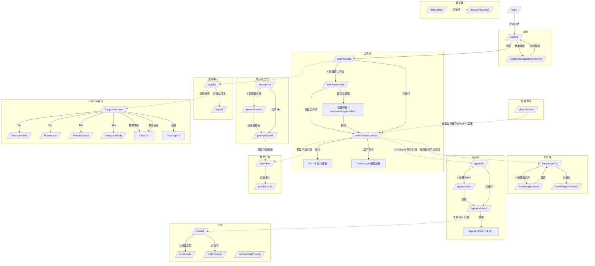

# 02 信息架构

## 一、侧边栏菜单树（唯一版本）

- 11 个一级菜单**平铺**，**无分组标题、无二级展开、无折叠按钮**（62 张截图中侧边栏结构完全一致，仅 08 告警中心/设置两张为旧版差异，如「应用 / LLMOps运维 / 系统监控 / 模型提供商」，不作为准）。
- 顺序固定（从上到下）：探索 → 工作流 → 应用中心 → 知识库 → Agent → 提示词工程 → LLMOps监控 → 插件市场 → 数据集 → 工具 → 模型厂商。
- 激活态：**整行紫色实底 `#6750A4` + 白字 + 白色线性图标**（实测 03/06 页抽样全行 `#6750A4`）；未激活：`#FEF7FF` 底 + 深灰文字（实测文字核心 `#43525A` 级蓝灰，抗锯齿混色）。
- 侧栏宽度 **202px**（实测 08 页 `x=202` 处 1px 分隔线 `#DBD8DC`；06 页 205px；03 页 152px 属缩放批次，不采用）。
- 无 Logo 区（Logo/平台名在顶栏左侧）；侧栏顶部无搜索、底部无版本号/折叠手柄。

| 顺序 | 菜单名 | 建议路由 | 图标含义猜测（Material 近似名） | 子项 |
|---|---|---|---|---|
| 1 | 探索 | `/explore` | 指南针 `explore` | 无（模板配置页为 `/explore/template/:key/config`，不在侧栏出现） |
| 2 | 工作流 | `/workflow/list` | 分支/流程树 `account_tree` | 无（画布页隐藏侧栏） |
| 3 | 应用中心 | `/app/list` | 应用格栅 `apps` | 无 |
| 4 | 知识库 | `/knowledge/list` | 书本 `menu_book` | 无 |
| 5 | Agent | `/agent/list` | 机器人头 `smart_toy` | 无 |
| 6 | 提示词工程 | `/prompt/list` | 代码/文档 `code` 或 `terminal` | 无 |
| 7 | LLMOps监控 | `/llmops/overview` | 显示器/心跳 `monitor_heart` 或 `insights` | 5 个 Tab 在页面内（非侧栏二级） |
| 8 | 插件市场 | `/plugin/market` | 星形 `star`（截图似星）或 `extension` | 无 |
| 9 | 数据集 | `/dataset/list` | 数据库 `storage` | 无 |
| 10 | 工具 | `/tool/list` | 扳手 `build` / `handyman` | 无 |
| 11 | 模型厂商 | `/providers` | 原子/联结 `hub`（截图似 ⚛ 原子符号） | 无 |

**路由高亮映射（必须按路由而非菜单文案判定）**

| 路由前缀 | 高亮菜单 |
|---|---|
| `/explore*` | 探索 |
| `/workflow*` | 工作流 |
| `/app*` | 应用中心 |
| `/knowledge*` | 知识库 |
| `/agent*` | Agent |
| `/prompt*` | 提示词工程 |
| `/llmops*` | LLMOps监控 |
| `/plugin*` | 插件市场 |
| `/dataset*` | 数据集 |
| `/tool*`（含 `/tool/template/config`） | 工具 |
| `/providers*` | 模型厂商 |
| `/login` | 无侧栏 |

> 原型缺陷：`11-工具-创建工具.png`、`11-工具-文本摘要器.png` 的高亮落在「数据集」，实现按上表纠正。

## 二、各模块页面族

| 模块 | 列表页 | 创建页 | 详情/编辑页 | 运行/调试态 | 原型缺失环节 |
|---|---|---|---|---|---|
| 登录 | — | `/login`（唯一页，含登录+第三方+注册入口） | — | — | 找回密码页、注册页、OAuth 回调 |
| 探索 | `/explore`（模板广场=列表） | — | `/explore/template/:key/config`（模板配置=创建态） | — | 模板详情页、我的收藏页 |
| 工作流 | `/workflow/list` | `/workflow/create`（模板选择）+ `?template=` 创建弹窗 | `/workflow/:id/canvas`（画布即编辑态） | `?run=1` 运行弹窗；`?node=<type>` 节点属性态 | 画布设置、分享、版本历史（工具栏图标已画但无内容） |
| 应用中心 | `/app/list` | `/app/list` 右上「+ 创建应用」（无独立页） | `/app/:id`（只读详情，编辑态为 `/app/:id/edit` 未画） | — | 创建表单页、编辑页、分析页、导出流程 |
| 知识库 | `/knowledge/list` | `/knowledge/create` | `/knowledge/:id/detail`（只读详情 + 快速操作） | 向量化进度（详情内进度条，非独立页） | 文档列表/分段预览/命中测试 Tab、编辑页 |
| Agent | `/agent/list` | `/agent/create` | `/agent/:id/detail`（Tab：配置/运行历史/工具管理，后两个未画） | 运行抽屉（未画） | 编辑页 `/agent/:id/edit`、运行调试抽屉、运行历史 |
| 提示词工程 | `/prompt/list` | `/prompt/create`（模板选择） | `/prompt/:id/edit`（Tab：提示词编辑/变量管理/模型配置，后两个未画） | 右侧「测试运行」面板（含在编辑页内，非独立页） | 变量管理 Tab、模型配置 Tab、历史版本 diff |
| LLMOps监控 | `/llmops/overview` + 4 个 Tab 页（models/cost/ab-test/security） | `/llmops/ab-test` 右上「创建新测试」（弹窗未画） | 实验详情/报告（未画） | 全局弹窗：`?alerts=1`、`?settings=1` | 创建测试弹窗、实验详情、报告导出 |
| 插件市场 | `/plugin/market` | 开发者中心（外链/未画） | 插件详情 `/plugin/:id`（**未画**，卡片无详情入口） | 安装态（安装中/已安装/需付费） | 插件详情页、安装/支付流程 |
| 数据集 | `/dataset/list` | `/dataset/list` 右上「+ 创建数据集」（无独立页） | `/dataset/:id/detail` | — | 创建表单、文档列表、统计报表、上传抽屉 |
| 工具 | `/tool/list` | `/tool/create` + `/tool/template/config`（模板配置） | `/tool/:id/detail`（只读 + 4 操作） | 运行工具抽屉（未画，复用提示词测试面板模式） | 工具编辑页、参数 schema 编辑器、使用统计页 |
| 模型厂商 | `/providers` | 「+ 添加提供商」（弹窗/抽屉未画） | `/providers/:id`（只读详情） | 测试连接（未画反馈） | 添加/配置抽屉、更新 API 密钥弹窗 |

### 页面族模板（4 段式，实现时按此抽壳）

| 段 | 统一骨架 | 代表页 |
|---|---|---|
| 列表 | PageHeader（标题+右上主按钮）→ 筛选条（搜索/状态/分类）→ DataTable 或 CardGrid → 分页 | `/workflow/list`、`/app/list`、`/knowledge/list`、`/agent/list`、`/prompt/list`、`/tool/list`、`/dataset/list` |
| 创建 | 返回箭头+标题（或居中标题）→ 模板/分类选择 → 表单卡（2 列栅格）→ 底部按钮行（取消/提交） | `/workflow/create`、`/knowledge/create`、`/agent/create`、`/tool/create`、`/explore/template/:key/config` |
| 详情/编辑 | 页头（返回+头像/图标+标题+状态+操作按钮组）→ Tab → 左只读信息卡 + 右操作/统计卡 | `/agent/:id/detail`、`/knowledge/:id/detail`、`/dataset/:id/detail`、`/tool/:id/detail`、`/providers/:id`、`/app/:id` |
| 运行/调试 | 输入区 + 输出区（左右或上下）+ 运行按钮 + 结果元信息 | `/workflow/:id/canvas?run=1`、`/prompt/:id/edit` 右侧面板、`/agent/:id` 运行抽屉（缺） |

## 三、主要跳转关系

### 跨模块数据依赖（跳转之外的隐式引用）

| 引用方 | 被引用方 | 引用字段 | 说明 |
|---|---|---|---|
| 工作流画布 LLM 节点 | 模型厂商 | 模型下拉选项 | `?node=llm` 面板「模型：GPT-4」 |
| 工作流画布 Agent 节点 | Agent | Agent 列表 | 原型配置区为空，需补 |
| 工作流画布 知识检索节点 | 知识库 | 知识库列表 | 面板「知识库」下拉 |
| 提示词编辑器 / 提示词模板配置 | 模型厂商 | 模型下拉 | 「AI 模型」「模型配置」Tab |
| Agent 创建 / 工具管理 Tab | 工具 | 工具列表 | 「工具配置」多选卡片 |
| 插件市场 | 工作流/Agent | 插件节点与工具 | 安装后可选 |
| 应用详情「查看分析」 | LLMOps监控 | 应用维度指标 | 跳 `/llmops/overview?appId=` |
| 成本页 / 概览告警 / 告警中心 | 同一告警数据源 | severity | 三处必须同源（原型 71.2% 与 78% 冲突） |

## 四、顶栏（全局）

| 位置 | 元素 | 实测/细节 | 交互 |
|---|---|---|---|
| 容器 | 紫色实底 `#6750A4`，高 **56px**（实测 08/06 批；03 批 49px 属缩放） | 无阴影、无分割线，与页面直接相接 | — |
| 左 | 平台名「AI 智能体应用开发平台」 | 白色 15–16px 半粗，无 Logo 图形 | 点击回 `/explore` |
| 右 1 | Admin 用户胶囊（圆头像 + 文字 + `⌄`） | 白底胶囊/白描边，头像圆形 | 下拉：个人信息 / 设置 / 退出 |
| 右 2 | 通知铃铛 | 红色圆点（部分页）或红色数字角标（3 / 5 / 8，各页不一致） | 打开通知面板（未画） |
| 右 3 | 电源/退出图标 | 白色线性图标，最右 | 退出登录 → `/login` |
| 变体 | 问号帮助图标、月亮图标（主题切换） | 仅 07-提示词管理、08-概览、12-模型提供商 出现 | 帮助中心 / 明暗主题（未画） |
| 缺失 | 全局搜索、面包屑、语言切换、租户切换 | 62 页均无 | 需产品决策是否补 |

> 顶栏没有面包屑，详情页返回依赖页头「← 返回箭头」（Agent/知识库/数据集/工具/模型厂商详情页部分连返回箭头都没有，需补面包屑）。

## 五、层级与浮层清单

| 层级 | 类型 | 出现页 | 建议实现 |
|---|---|---|---|
| L0 | 全屏无壳（无侧栏无顶栏） | `/login` | 独立 Layout |
| L1 | AppShell（顶栏+侧栏+内容） | 除 login、画布外的全部页 | 默认 Layout |
| L1' | 无侧栏（顶栏+三栏工作区） | `/workflow/:id/canvas` | CanvasLayout：节点库替代侧栏 |
| L2 | 页面内 Tab | Agent 详情（3）、提示词编辑（3）、LLMOps（5）、模型提供商（4） | 下划线 Tab / 胶囊 Tab |
| L3 | 模态弹窗 | 创建工作流、运行工作流、告警中心、LLMOps 设置、删除确认（未画） | 居中，圆角 12–16px，遮罩 `rgba(0,0,0,.4)` |
| L4 | 右侧抽屉 | 节点属性面板（画布右栏，宽约 300px） | 画布内固定栏，非浮层 |
| L5 | Toast | 全部写操作 | 右下或顶部居中，3s |
